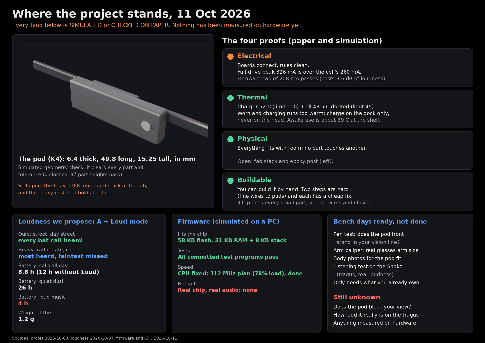

# Progress, 11 Oct 2026

All of this is simulated or checked on paper. Nothing is measured on hardware yet.

- **Electrical:** boards connect and are rule-clean. Full-drive peak (326 mA) exceeds the cell (260 mA); the firmware cap (208 mA) passes at a cost of 3.6 dB. Cap unconfirmed on the bench.
- **Thermal:** charger 52 C, cell 43.5 C docked (limit 45). Do not charge while worn. Awake ~39 C shell.
- **Physical:** K4 pod 6.4 x 49.8 x 15.25 mm; 0 clashes. Open: 6L 0.8 mm board stack at JLC, epoxy post.
- **Buildable:** ~6.7 h hands-on for pod 1; two hard steps, each with a cheap fix.
- **Loudness A + Loud:** every call heard on quiet and day streets, most heard in traffic/cafe/car; 8.8 h calls (11.9 h without Loud), 26 h dusk (runtimes re-run 2026-10-11 after the duty-normalisation fix), 4 h loud music; 1.2 g.
- **Firmware:** 58 KB flash, 31 KB RAM + 8 KB stack; committed fwsim is green (the earlier "53/57" was a mid-edit run); CPU fix DONE at the 112 MHz plan (78 % load).
- **Bench day 1:** run sheet ready (pen test, arm caliper, body photos, Shokz listening).
- **Unknown:** does the pod block the vision line; real loudness on the tragus; any hardware measurement.

## since 07:30
- Simulated: slim B (P72) vs shipping B (P112) on Port Meadow: same wake recall 0.854 and false wakes, sound recall -0.4 pt, 1.8 mA less (+2.0 h dense usable); slim is the better trade unless E2 listening hears the 16 bands (docs/sim/alt-slim-vs-b.md).
- Simulated: hiz_idle ON vs OFF (B/slim): +0 h dense, +0.7/+1.0 h walk, +2.7/+3.3 h dusk usable; re-enable/stop click SPICEd (real fw start phase, motional coil) is 30-46 dB under tragus threshold, no soft-start needed; default stays OFF pending PWR-I12 and a restart-AF-mux check (docs/sim/alt-hiz-idle.md).
- Firmware bug found and fixed (c472455): after the speaker driver was parked once (hiz_idle), its pins were never handed back to the timer, so the bridge would have stayed silent. Register test added; fwsim 35/35 PASS. hiz_idle stays off until the bench idle-current check.
- Simulated since 07:30: three false-wake cuts (confirm-N, band-width reject, adaptive threshold) tested on Port Meadow with a train/holdout split: none cuts false wakes (3.5/min) beyond noise without losing wake recall (0.858); defaults unchanged, docs/sim/alt-false-wake.md.
